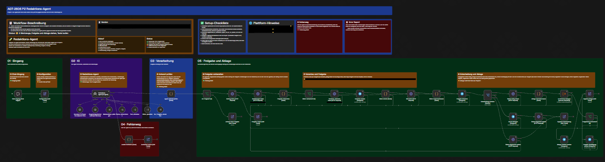
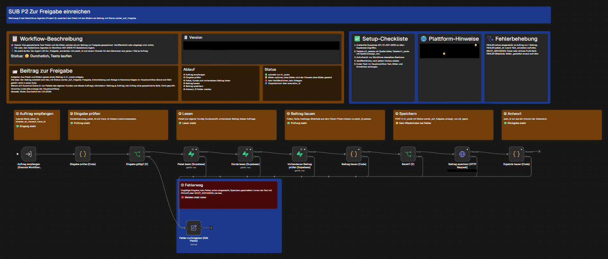

# Changelog: Redaktions-Agent K2

> Alle Fassungen der Systemprompts des Redaktions-Agenten (Projekt 2, Kurs AGT-2606), die jüngste zuerst. Jeder Eintrag nennt Datum, Status und Version und sagt in höchstens 3 Sätzen, was sich geändert hat. Die Stände der einzelnen Workflows stehen in [versionen.md](versionen.md), die Tests in [docs/test-tabelle.md](docs/test-tabelle.md).

## Namensschema

| Teil | Schreibweise | So sieht es aus |
|---|---|---|
| Datum | `YYYYMMDD` | `20261110` |
| Version | `V<Nummer>` | `V1`, `V2` |
| Gegenstand | `System-Prompt-Redaktions-Agent` | |
| Kurztext | höchstens 3 Sätze zu Änderung, Wirkung und nächstem Schritt | in jedem Eintrag unten |

Name der Prompt-Datei: `YYYYMMDD_System-Prompt-Redaktions-Agent_V<Nummer>.md`. Je Eintrag gehören die Prompt-Datei und die exportierte Agent-Konfiguration (JSON) dazu. Archivierte und verworfene Fassungen liegen in [archiv/](archiv/), die Workflow-Versionen mit demselben Status stehen in [versionen.md](versionen.md).

### Statuswerte

Dieselben 4 Statuswörter stehen in der Spalte Status von [versionen.md](versionen.md).

| Status | Bedeutung |
|---|---|
| Live | der geltende Stand |
| In Test | Testkopie oder Kandidat in Erprobung (Testkopien werden nicht Live) |
| Archiviert | abgelöst durch eine spätere Version, Datei unter `archiv/` |
| Verworfen | getestet, nicht übernommen; dazu steht, welcher Stand live bleibt |

---

## Versionen

Kürzel: F1 bis F5 sind die 5 Testfälle der Testreihe mit 1 Werkzeug. V2 steht oben, weil es nach dem Rückbau von V3 wieder gilt; V3 ist verworfen (getestet, nicht übernommen), V1 ist archiviert.

### `20261110_System-Prompt-Redaktions-Agent_V2.md`

| | |
|---|---|
| **Datum** | 10.11.2026 (seit 11.11.2026 mit allen 5 Werkzeugen) |
| **Status** | Live |
| **Agent** | Redaktions-Agent |
| **Version** | V2 |
| **Prompt-Datei** | [prompts/20261110_System-Prompt-Redaktions-Agent_V2.md](prompts/20261110_System-Prompt-Redaktions-Agent_V2.md) |
| **Agent-Konfiguration** | [konfiguration/20261111_Redaktions-Agent_V2_Agent-Konfiguration.json](konfiguration/20261111_Redaktions-Agent_V2_Agent-Konfiguration.json) |

**Beschreibung:** V2 entstand nach beobachteten Fehlern von V1 (Läufe liefen in „Max iterations“, vermutlich weil Werkzeuge fehlten). Am 11.11.2026 kamen Werkzeug 4 (Bilder) und 5 (Einreichen) dazu, dazu Freigabe und Ablage im Hauptworkflow. Der Vergleich mit V1 an denselben 10 Anfragen steht in der [Test-Tabelle](docs/test-tabelle.md).

**Änderungen gegenüber V1:**

- Schritt 8: fehlt ein Werkzeug, sofort `status` fehler ohne Werkzeugnamen. Ziel war, den Abbruch in „Max iterations“ bei fehlenden Werkzeugen zu vermeiden; das gelang nicht: In der Testkopie mit 1 Werkzeug endete Testfall F2 mit v2 weiterhin in „Max iterations“ (Läufe 2653 und 2662), mit v3 ebenso. Vermutete Ursache: der Werkzeug-Aufbau, siehe V3 (Einzelmessung offen).
- Text_schreiben genauer beschrieben, Zahlen nur mit Quelle, Wiederholung bei unbelegten Zahlen.
- Der Agent gibt nur die `paket_id` weiter, das Paket liegt in `k2_pakete` (Workflow-Änderung am 11.11.2026, Prompt-Text unverändert).

**Ergebnis (Baseline 11.11.2026, 10 Anfragen, Modell Nemotron 3.5 Super free):** Die Werkzeugwahl stimmt bei dem Auftrag mit Text und Bildern (Anfrage 1), die Ausgabe-Prüfung fängt falsche Antworten ab. Schwächen: ruft Bilder auch bei „keine Bilder“ (Anfrage 2), bearbeitet Off-Topic-Aufträge (Anfrage 10), ruft bei Smalltalk Text und Einreichen (Anfrage 7, bei V1 ebenfalls), Statuswert für reine Auskünfte fehlt (Anfrage 4). Gegen V1: v2 vollständig bestanden 2 von 10, v1 5 von 10 (1 Lauf je Anfrage, Gratismodell, nur eine Richtung). V1 war bei Anfrage 2, 3, 6, 8 und 10 besser, V2 bei Anfrage 5 und 9; bei Anfrage 1, 4 und 7 schnitten beide gleich ab (bei Anfrage 7 beide nicht bestanden, v2 erzeugte aber keinen Post, v1 erzeugte und gab einen Post frei). Freigabe und Ablage nach dem Klick in Telegram liefen in 3 Läufen durch (2768 und 2782 mit v2, 2748 mit v1); der Ablehnen-Zweig lief mit Lauf 2735 durch (Status abgelehnt, Grund gespeichert). Bis v14 ging nach dem Klick keine Bestätigung an Telegram; seit v15 (Lauf 2782) kommt die Nachricht „Freigegeben und in Nextcloud abgelegt“ mit dem Link zum Kundenordner.

**Nächste Idee:**

- V4 aus den Funden: „Verlangt der Auftrag keine Bilder, überspringe Schritt 5“, Statuswert `auskunft`, Off-Topic klar ablehnen, Smalltalk ohne Werkzeug.

---

### `20261110_System-Prompt-Redaktions-Agent_V3.md`

| | |
|---|---|
| **Datum** | 10.11.2026 |
| **Status** | Verworfen (live bleibt V2) |
| **Agent** | Redaktions-Agent |
| **Version** | V3 |
| **Prompt-Datei** | [archiv/prompts/20261110_System-Prompt-Redaktions-Agent_V3.md](archiv/prompts/20261110_System-Prompt-Redaktions-Agent_V3.md) |
| **Agent-Konfiguration** | [archiv/konfiguration/20261110_Redaktions-Agent_V3_Agent-Konfiguration.json](archiv/konfiguration/20261110_Redaktions-Agent_V3_Agent-Konfiguration.json) |

**Beschreibung:** V3 ergänzte Schritt 8 um einen Satz (fehlen Schreiben, Bilder oder Einreichen in der Werkzeugliste, sofort `status` fehler). Wirkung: keine, F2 und F4 endeten weiter im Fehlerweg. Verworfen: getestet, nicht übernommen, live bleibt V2.

**Änderungen:**

- Ein Satz in Schritt 8 → ohne Wirkung, am Abend auf V2 zurückgebaut.

**Nächste Idee:**

- Die Ursache liegt vermutlich im Werkzeug-Aufbau, nicht im Prompt (vermutlich, weil der Prompt nicht angebundene Werkzeuge nannte; Einzelmessung offen): erst Testkopie mit 1 Werkzeug, dann alle Werkzeuge bauen (so am 11.11.2026 geschehen).

---

### `20261109_System-Prompt-Redaktions-Agent_V1.md`

| | |
|---|---|
| **Datum** | 09.11.2026 |
| **Status** | Archiviert |
| **Agent** | Redaktions-Agent |
| **Version** | V1 |
| **Prompt-Datei** | [archiv/prompts/20261109_System-Prompt-Redaktions-Agent_V1.md](archiv/prompts/20261109_System-Prompt-Redaktions-Agent_V1.md) |
| **Agent-Konfiguration** | [konfiguration/20261109_Redaktions-Agent_V1_Agent-Konfiguration.json](konfiguration/20261109_Redaktions-Agent_V1_Agent-Konfiguration.json) |

**Beschreibung:** Erste Fassung (6 Bausteine: Rolle, Kontext, Vorgehen, Werkzeuge, Regeln, Fallback). Läuft in der Baseline 11.11.2026 besser als V2 bei Anfrage 2, 3, 6, 8 und 10.

**Änderungen:**

- Keine, Ausgangsfassung.

**Nächste Idee:**

- Schritt für fehlende Werkzeuge und genauere Werkzeugbeschreibung (→ V2).

---

## Arbeitsschritte 11.11.2026

Die Prompt-Versionen stehen oben, hier die Arbeitsschritte des Tages (Zeit lokal). Die Stände, versionIds und Commits aller Workflows stehen in [versionen.md](versionen.md).

| Zeit | Schritt | Ergebnis |
|---|---|---|
| 11:26 | Paket-Speicher: Tabelle `k2_pakete`, Werkzeug 3 speichert das Paket je `paket_id` (v07) | Lauf 2687: Zeile gespeichert, Agent reicht nur die `paket_id` weiter |
| 11:36 | Werkzeug 4 Bilder gestalten gebaut (v01), im Hauptworkflow angebunden (v08, 11:38) | Auswahltest folgt nach dem Modellwechsel (v09, 11:51, Lauf 2693: 7 Bilder, Quelle KI-Bild) |
| 11:46 | Werkzeug 5 Zur Freigabe einreichen gebaut (v01), angebunden (v11, 11:58) | Lauf 2701: alle 4 Schritte, Freigabe-Anfrage in Telegram |
| 11:51 | Agent-Modell auf Nemotron 3.5 Super free (v09), weil der Endpunkt von Nemotron 3 Ultra ausfiel | Läufe 2690 bis 2692 Zeitüberschreitung, danach deutlich besser, zeitweise weiter langsam |
| 11:57 | Freigabe und Ablage im Hauptworkflow (v10) | Telegram-Freigabe, Entscheidung, Status, Ablage in Nextcloud |
| 12:11 | Vergleich Prompt v1 gegen v2 mit 10 Anfragen (v12 vorübergehend mit v1, 12:18 Rückbau auf v2, v13) | [Test-Tabelle](docs/test-tabelle.md) |
| 12:22 | Vorschau in Telegram als lesbare Zeilen im HTML-Modus (v14) | Ursache des HTTP 400: Telegram entfernte Unterstriche in den Links |
| 12:43 | Telegram-Bestätigung mit Link zum Kundenordner nach der Ablage (v15) | Lauf 2782 |
| 12:56 | Notiztext der Karte „Entscheidung und Ablage“ (v16) | nur Text |
| 13:00 | Ablehnen mit Grund getestet | Lauf 2735, Grund-Abfrage per Webformular |
| 18:05 | Archiv, Status, Versionsmatrix, `.env.example`, Verbindung zu Projekt 1 | 54 ältere Workflow-Versionen bereinigt unter [archiv/workflows/](archiv/workflows/), Testkopien in [workflows/test/](workflows/test/), Spalten Status und Archivdatei in [versionen.md](versionen.md) (6 Live, 4 In Test, 2 Verworfen, 50 Archiviert), [docs/versionsmatrix.md](docs/versionsmatrix.md), [.env.example](.env.example), Tabelle der Workflow-Dateien und Abschnitt „Grundlage aus Projekt 1“ im [README](README.md); Prompt und Konfiguration V3 als Verworfen geführt, Funktion der Workflows unverändert |
| abends | Korrekturen nach Durchsicht: Archiv und Status, Doku-Seiten, Testzahl, Zusatzfunktionen | Archiv und Status: V3 überall als Verworfen geführt (live bleibt V2), Tag 1 verweist für ältere Stände aufs Archiv. Doku-Seiten: Selbsthinweis zur Gliederung entfernt, Zahlen als Ziffern. Testzahl: Tag 2 und Plan v07 nennen „3 von 3 ausgeführten“ Fällen mit Testprompt statt „5 von 5“ (Frage 3 und 5 sind nicht mit dem Testprompt gelaufen). Neuer Abschnitt „Zusatzfunktionen“ im [README](README.md) und in [docs/index.html](docs/index.html): Human in the Loop umgesetzt (3 Freigaben, 1 Ablehnung), Monitoring und Alerting als Ansatz, die übrigen 5 nicht umgesetzt. [docs/versionsmatrix.md](docs/versionsmatrix.md): Zusatzexport „7 Felder mehr“ statt „3“ (nachgezählt an allen 3 Zusatzexporten). Funktion der Workflows unverändert |
| 21:00 | Anordnung der Werkzeug-Workflows im Editor und Notiztexte überarbeitet: Hauptworkflow v16.2, Markenwissen v03.3, Recherche v03.2, Text v07.1, Bilder v01.2, Freigabe v01.2 | Funktion unverändert; die bisherigen Stände liegen unverändert unter [archiv/workflows/](archiv/workflows/), Zeilen in [versionen.md](versionen.md) |
| später | Planbild Tag 3 überarbeitet: alle Pfeile schwarz, die 5 Werkzeuge hängen mit 1 beschrifteten Eingangspfeil am Agenten, Einstiege markiert; Projekt-Charter in Fassung 6 und als Webseite | [docs/plan/](docs/plan/), [docs/charter.html](docs/charter.html), der Stand davor unter [archiv/plaene/](archiv/plaene/) |

Gesamtansichten nach der Anordnung am Abend (von den 6 Workflows zeigt die [Tages-Doku](docs/w08t03.html) 4 Bilder: Hauptworkflow, Werkzeug 1, 4 und 5), hier der Hauptworkflow und Werkzeug 5; Adressen und Ablagehinweise sind geschwärzt:

## Stände der Werkzeuge und Workflows (11.11.2026)

| Gegenstand | Stand | Datei |
|---|---|---|
| Hauptworkflow Redaktions-Agent | v16.2, nicht veröffentlicht | `workflows/redaktions-agent.json` |
| Werkzeug 1 Markenwissen abfragen | v03.3 | `workflows/sub-markenwissen-abfragen.json` |
| Werkzeug 2 Thema recherchieren | v03.2 | `workflows/sub-thema-recherchieren.json` |
| Werkzeug 3 Text schreiben | v07.1, speichert das Paket (k2_pakete) | `workflows/sub-text-schreiben.json` |
| Werkzeug 4 Bilder gestalten | v01.2, ohne Layout 4 | `workflows/sub-bilder-gestalten.json` |
| Werkzeug 5 Zur Freigabe einreichen | v01.2 | `workflows/sub-zur-freigabe-einreichen.json` |
| Paket-Speicher | Tabelle `k2_pakete` | `sql/p2_k2_pakete_v01.sql` |

Das Agent-Modell wechselte am 11.11.2026 von Nemotron 3 Ultra free auf Nemotron 3.5 Super free, weil der Endpunkt von Ultra zeitweise ausfiel.
